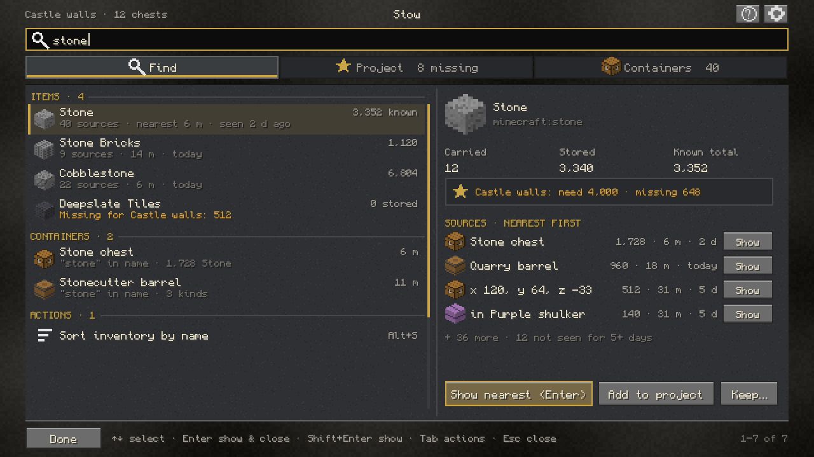
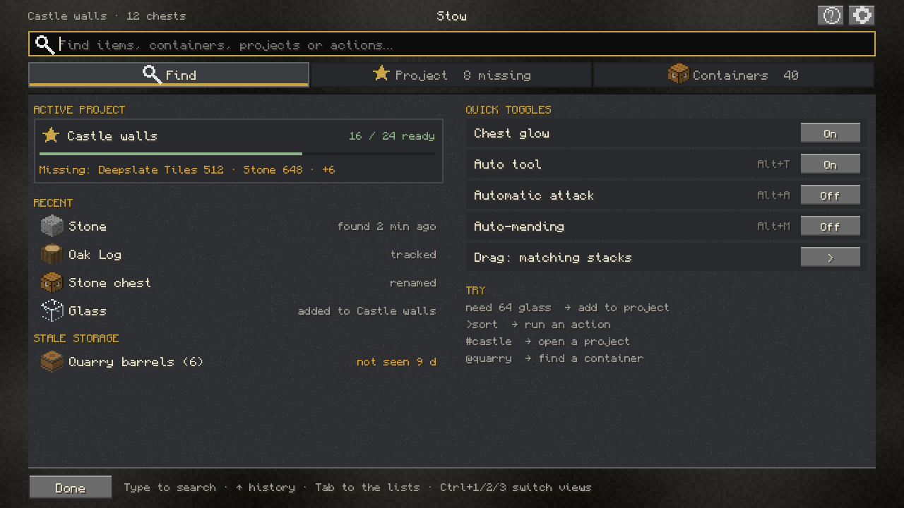
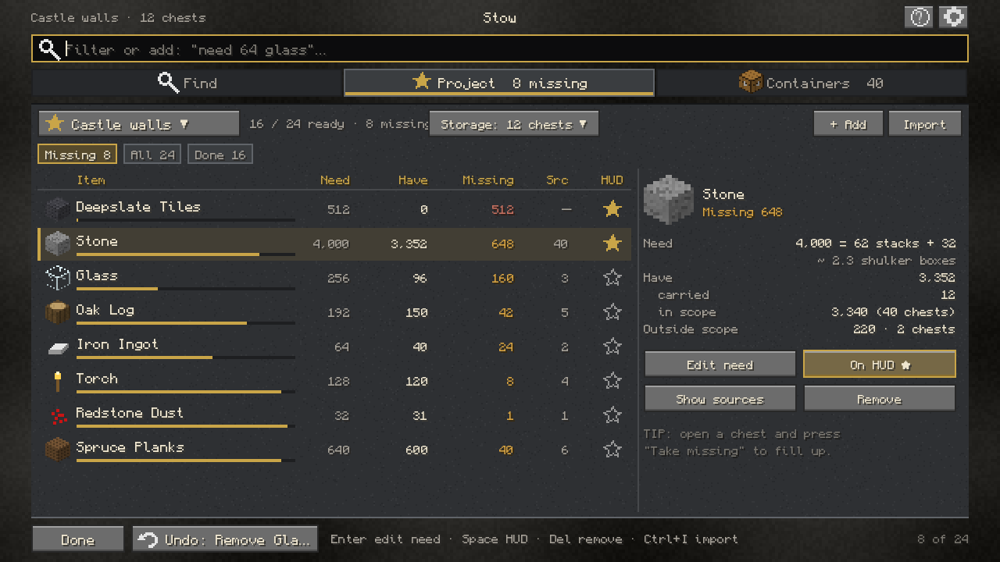
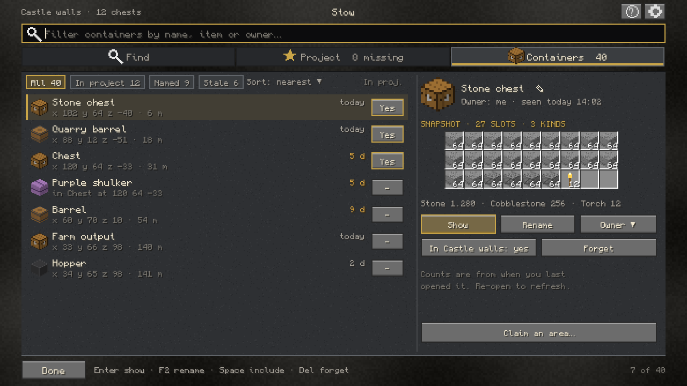
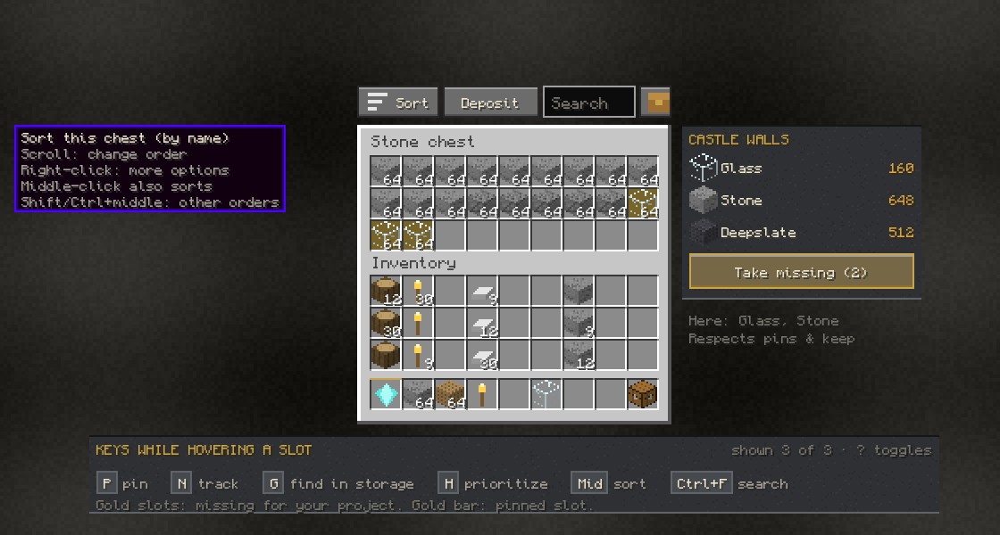
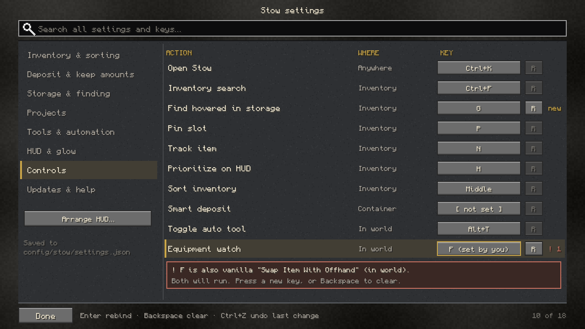
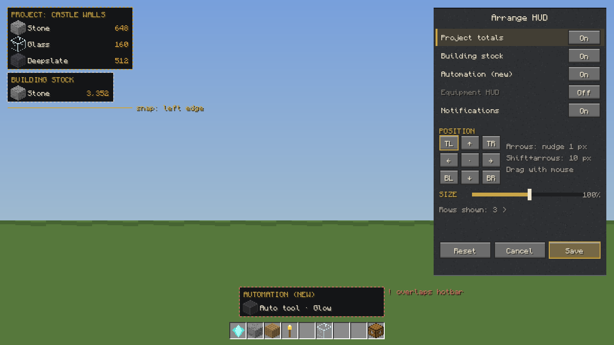
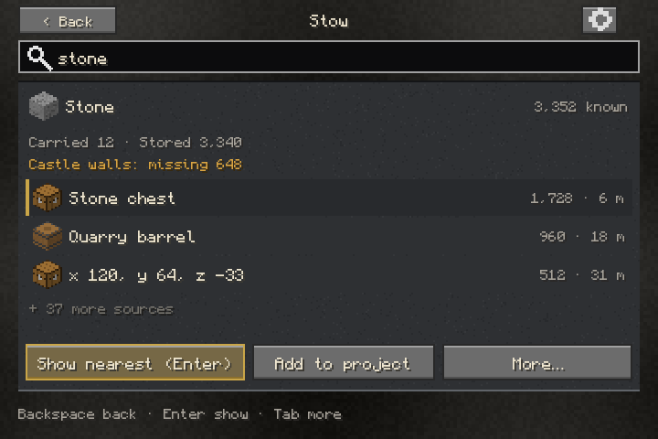

# Stow redesign v2: information architecture, workflows and visual design

Status: **design proposal, phase 1 of 3** (2026-10-20). No UI code has been written, and
nothing has been committed or published. It replaces the rejected overhaul design on
`codex/stow-overhaul` and starts again from released 1.0.6 (`main` @ `5dd38ff`).
Inputs: `docs/validation/baseline.md` (B-numbers),
`docs/research/2026-10-20-0{1..4}-*.md` (DD = deep dive, F = finding).
Mocks are on-box renders (PIL, Monocraft font OFL-1.1, procedural item sprites; **no
Mojang assets**). They show layout and hierarchy, not final pixels. Their pixel widths
are approximate (see §8).

## 1. Goals and principles

1. **Item first, task first.** Players ask "where is X" and "what am I missing", not
   "which chest is this". (F2, F6)
2. **One place, one state.** A single Stow screen, so switching views never loses the
   query, selection or scroll. (F1)
3. **Finish the job in the world.** Locating closes the screens and shows the result. (F3)
4. **Visible before hidden.** Every gesture also has a visible control or legend at the
   place you use it. (F8, F9)
5. **Same rules, same data.** Every 1.0.6 capability, `config/stow/settings.json`, the
   per-world stores, exact item and component conservation, and Companion server
   authority stay as they are. v2 changes structure, not guarantees. (§10)
6. **Vanilla-plus look.** Mineral gray panels, cream text, restrained gold for focus and
   primary actions, and real item icons. Colour is never the only signal. (§6, §9)

## 2. Information architecture

```
World ── E inventory / any container
          ├─ Inventory strip: [Sort ▼] [Deposit] [search] [Stow] [?]   (+ project strip, key legend)
          │     hover keys: P pin · N track · H prioritize · G find in storage (new)
          └─ Stow button / Ctrl+K ──► STOW SCREEN
                 ┌ query bar (always focused; also runs actions: ">sort", "#castle", "need 64 glass")
                 ├ FIND        items · containers · actions · projects matching the query
                 │             empty query = "Now": active project, recent, stale storage, quick toggles
                 ├ PROJECT     switcher ▼ · scope chip · Missing/All/Done · table · detail · Import drawer
                 ├ CONTAINERS  filters · list (include-in-project toggle) · detail (snapshot grid,
                 │             rename, owner, show, forget) · Claim an area…
                 └ ⚙ SETTINGS  search · task categories · Controls · Arrange HUD… · What's new
World HUD: Project totals · Building stock · Equipment HUD · Automation (new) · toasts · glow
```

**Capability map (1.0.6 → v2).** Every row in baseline §1.1 still has a home:

| 1.0.6 screen / control | v2 home |
| --- | --- |
| Materials (`MaterialsScreen`) | Project segment (table + detail) |
| Storage (`StorageScreen`) | Find (item-first) + Containers (container-first) |
| Project chests chooser | Project scope chip → in-pane picker, and the include toggle in Containers |
| Projects screen | Project switcher drop-down |
| Material picker / Import / Review row | Query "need …", Import drawer with candidate chips |
| Rename / Storage owner | Containers detail (inline rename, Owner ▼) |
| Claim area / Area selection | Containers → Claim an area… (camera starts directly) |
| Quick actions palette | The query bar ("`>`" filters to actions; actions are also listed in Find results) |
| Cloth settings (7 categories) + Shortcut editor + Keep amounts | Native settings: task categories, Controls page, inline Keep table |
| 3 × `DockLayoutScreen` | One Arrange HUD editor |
| Equipment watch (unbound only) | Settings → HUD, Find action "Equipment watch", HUD element click-through |
| `ToolListScreen` (no entry point) | Phase 2: confirm unreachable, then either wire it into Find actions or delete it |
| What's new / update notice | Settings → Updates & help, with "Show me" links; notice unchanged |
| Toolbar icons (drag mode, storage, materials, palette, deposit, glow) | Strip: Sort ▼ (drag mode inside), Deposit, search, Stow; Stop-glow chip only while glowing |

## 3. Screens

All screens keep Stow's menu style: centred title, full-page `menu_list_background`-style
panel, vanilla buttons, a footer with Done / named Undo / range, and vanilla slot frames.

### 3.1 Stow screen shell

```
┌ Castle walls · 12 chests ─────────── Stow ──────────────── [?] [⚙] ┐
│ [🔍 query…                                                       ] │
│ [ Find ][ ★ Project  8 missing ][ ▣ Containers  40 ]               │
│ ┌ list (≈55%) ───────────────────┬ detail (≈45%) ─────────────────┐ │
│ │ group headers, 20–24 px rows   │ icon 32, facts, sources, actions │ │
│ └────────────────────────────────┴──────────────────────────────────┘ │
│ [Done] [↶ Undo: <named action>]  key hints …              1–7 of 7 │
└──────────────────────────────────────────────────────────────────────┘
```

- Opened by Ctrl+K (old palette key), the Stow button on the strip, Mod Menu, or a
  shortcut per segment (unbound by default, as now).
- Opening Stow from an open container preselects that container in Containers. Opening it
  with a hovered item puts that item's name in the query.
- Session state per segment (query, selection, scroll, filter chips) lives until the
  world is left. The settings.json fields stay unchanged; this state is in memory only.
- Ctrl+1/2/3 or Tab-cycling switches segments; Esc closes (or goes back in compact).

### 3.2 Find



- Groups: **Items · Containers · Actions · Projects**, each capped (5 / 3 / 3 / 2) with
  "Show all n". Items are ranked by match quality, then by known total.
- Item row: icon, name, **known total** (carried + stored), source count, nearest
  distance, freshness. If an active-project need is unmet, the subline says
  "Missing for Castle walls: n" in ochre text (the words carry the meaning, the colour
  only supports it).
- Detail: Carried / Stored / Known total; project need; **sources nearest first** with
  count, distance, age and a Show button each; "12 not seen for 5+ days".
- Actions: **Show nearest (Enter)** = start the glow and close all screens; Shift+Enter =
  glow but stay; *Add to project*; *Keep…*; *Track* (same as N).
- Counts are always labelled "known" and come from snapshots. The staleness rule from
  1.0.6 stays.

Empty query ("Now"):



The active project card, recent items/containers (in-memory history), stale storage, and
**quick toggles** that 1.0.6 hides until you type in the palette (chest glow, auto tool,
automatic attack, auto-mending, drag mode). There are also syntax hints. Prefixes are
optional shortcuts; plain words work everywhere.

### 3.3 Project



- Header: **switcher ▼** (list of projects + Create / Rename / Finish / Reopen / Delete),
  progress "16 / 24 ready", **scope chip** "Storage: 12 chests ▼" (opens an in-pane
  container checklist with All / None / Nearby), + Add, Import.
- Chips: **Missing n** (default) / All n / Done n.
- Table: Item | Need | Have | Missing | Src | HUD (★). A thin progress bar under each name
  is gold until complete, then sage, with "✓ ready" text in the Missing column.
- Detail: the need broken into stacks and shulker boxes (Litematica style, DD 4), Have
  split into carried / in scope / **outside scope** (makes a too-narrow scope visible),
  plus Edit need, On HUD ★, Show sources, Remove.
- Add: type `need 64 glass` in the query, or the + Add button (picker + amount).
- **Import drawer** slides over the table: paste → parsed rows with status chips
  (Matched / Pick one / Unknown). Ambiguous rows show **candidate item chips** inline, so a
  correction is 1 click instead of Edit → type → choose → Use. Merge / Replace toggle,
  Import n.
- Finish stays locked until every need is met (as in 1.0.6) and explains why.
- Undo is named: "Undo: Remove Glass".

### 3.4 Containers



- Chips: All / In project / Named / Stale; sort nearest ▼ / name / last seen.
- Row: dye-tinted icon (keeps v4 dye metadata), name or coordinates, distance, last seen
  (ochre text if older than the stale threshold), **include-in-project** toggle.
- Detail: inline rename (F2 / pencil), Owner ▼ (Companion: Claim as mine, clear;
  disabled with a reason text when the Companion is absent), read-only snapshot grid,
  item summary, Show, Forget (with Undo), "In <project>: yes/no".
- **Claim an area…** opens area selection directly (§3.8).

### 3.5 Inventory strip and container overlays



- Strip above the container (or the right column when there is no room, as now):
  **Sort ▼** (click = sort this container or the inventory; scroll = change order;
  right-click = options: order, hotbar scope, drag mode), **Deposit** (shown only when
  the container accepts smart deposit), **search** (Ctrl+F), **Stow** (opens the Stow
  screen preselecting this container), **?** (legend).
- 6 icons become 4 controls + search. The glow toggle becomes a **Stop glow** chip that
  only appears while a glow is active (1 click, same as now).
- **Project strip** (replaces the floating tracker): missing items for the active
  project; left-click edit, right-click glow (unchanged), plus **Take missing (n)** when
  this container holds any (N3).
- **Matching-slot highlight** (N4): slots holding missing project items get a gold fill
  *and* a corner marker. Pinned slots keep their padlock/bar marker.
- **Key legend**: shown for the first 3 container opens after install/update, then only
  with `?`. It lists P, N, G, H, middle-click and Ctrl+F using the player's actual bindings.
- Placement is collision-aware. Phase 2 will check the known button zones of IPN, Chest
  Tracker and recipe-viewer overlays (coexistence testing is deferred).

### 3.6 Settings (native)



- Same panel style as the Stow screen. A **global search** over setting names, help
  text and key names, with results that jump to the row.
- Task categories: Inventory & sorting · Deposit & keep amounts · Storage & finding ·
  Projects · Tools & automation · HUD & glow · Controls · Updates & help.
- Rows: label, control, help on hover/focus, "changed" marker with per-row reset. Changes
  apply live, like Cloth's Save but without a separate Save step. Ctrl+Z undoes the last
  change. Writes stay atomic (`.tmp` → rename).
- **Keep amounts** is an inline editable table (item, amount, remove) instead of a child
  screen.
- **Controls**: Action | Where (Anywhere / Inventory / Container / In world) | Key | reset.
  It shows conflicts with vanilla and Stow keys. *Example in the mock: the user bound
  Equipment watch to F, which vanilla uses for Swap Item With Offhand. "Both will run" is
  **Inferred** from the fact that Stow's handler is not a KeyMapping and must be verified.*
- The Mod Menu config entry opens this screen.
- Dropping Cloth Config is a dependency change and needs a decision (§12).

### 3.7 Arrange HUD



One editor for every HUD element (Project totals, Building stock, Equipment HUD,
Automation status (new), toasts). It has an element list with on/off, drag, arrow-key
nudge (Shift ×10), a corner grid, snap guides with labels, a size slider (existing
100–200 % and per-element size), rows shown, overlap warnings (clay outline **and** "!
overlaps hotbar" text), and Reset / Cancel / Save. It is reached from Settings → HUD &
glow, Find actions ("arrange hud"), and right-click on a HUD element's title in the editor
preview. Positions stay in the existing settings fields; a new field is added only for
the new Automation element.

### 3.8 Area claim (Companion)

Containers → Claim an area… now **starts the camera directly**, dropping the 1.0.6
"Fly and select" step. LC = corner 1, RC = corner 2, scroll = height. A proposed **V** key
sets full allowed height, adapted from WorldEdit `//expand vert` (DD 10). A live readout
shows "12 × 7 × 30 · 41 containers". Enter confirms, Backspace undoes, Esc goes back. The
server still validates ownership and limits; nothing changes in the Companion protocol.

### 3.9 Smaller screens

- **What's new**: entries gain "Show me" links that open the relevant segment or setting.
  It is reachable from Settings → Updates & help and the query ("what's new").
- **Equipment watch**: reachable from Find actions and Settings → HUD (it no longer
  requires binding a key first).
- **Rename / Owner / Picker / Review** dialogs are absorbed into inline controls, which
  removes 4 screen classes.

### 3.10 Compact layout



- **Wide** when the content width is ≥ 600 GUI px (e.g. 1920×1080 at GUI scale 3 gives
  640): master/detail side by side.
- **Compact** otherwise (e.g. GUI scale 4 at 1080p ≈ 480 wide; 1366×768 at scale 3 ≈
  455): the list fills the panel and Enter/click pushes the detail view with a **‹ Back**
  button (Backspace or Esc). Segment labels shorten ("Containers" → "Boxes" in EN and
  "Behälter" in DE, which fits), counts collapse to badges, and the footer keeps only the
  primary hint.
- Below 360 GUI px the footer hints are dropped and the detail actions wrap to 2 rows.
- Row heights stay 20–24 px in both layouts, so the click targets stay the same size.

## 4. Keyboard and mouse flows

| Context | Key / mouse | Effect |
| --- | --- | --- |
| Anywhere | **Ctrl+K** | Open Stow (query focused; hovered item pre-filled if any) |
| Stow | type | Filter the current segment (Find searches everything) |
| Stow | ↑ / ↓ | Move selection; ↑ in an empty query = previous query (N6) |
| Stow | **Enter** | Primary action (Find: Show nearest & close; Project: edit need; Containers: Show) |
| Stow | Shift+Enter | Show and stay |
| Stow | Tab / Shift+Tab | Cycle focus: query → list → detail actions → footer |
| Stow | Ctrl+1/2/3 | Find / Project / Containers |
| Stow | Ctrl+Z | Undo the named last change (same history as 1.0.6) |
| Stow | Esc / Backspace (compact) | Back from the pushed detail, otherwise close |
| Project | Space / Del / Ctrl+I | Toggle ★ HUD / remove (Undo) / Import drawer |
| Containers | F2 / Space / Del | Rename / include in project / forget (Undo) |
| Container screen | hover + **P / N / H** | Pin / track / prioritize (unchanged) |
| Container screen | hover + **G** (proposed) | Find hovered item in storage: show nearest, or open Find if there is none |
| Container screen | middle-click, Shift/Ctrl+middle | Sort (unchanged); also the Sort button |
| Container screen | scroll on Sort | Change sort order |
| Container screen | **?** | Toggle the key legend |
| Area claim | LC / RC / scroll / V / Enter / Backspace / Esc | Corners / height / full height / confirm / undo / back |
| Arrange HUD | drag, arrows, Shift+arrows | Move, nudge 1, nudge 10 |

Mouse: every keyboard action has a visible button. Hover tooltips name the key. Right-click
on Sort or project-strip items opens options/glow, as in 1.0.6.

## 5. Step counts: predicted v2 vs 1.0.6 baseline

Same notation as the baseline (K/C/D/T/S, start in the world unless stated). These
counts are **predicted from the design** and have not been measured.

| ID | Job | Baseline | v2 | v2 sequence |
| --- | --- | --- | --- | --- |
| B1–B5 | Sort / deposit / pin / search | 1, 2, 1, 1, 1+T | same | unchanged gestures, now also visible |
| B6 | Find an item and see it in the world | **5 + T** | **2 + T** | Ctrl+K, T, Enter (in a container: hover + G, Enter = 2) |
| B7 | Track hovered item | 2 (+T) | 2 (+T) | unchanged |
| B8 | Add material by name | 5 + 2T | 3 + 2T (2 + T) | Ctrl+K, Ctrl+2, + Add, T, T… or Ctrl+K, "need 64 glass" Enter |
| B9 | Import, per ambiguous row | 3 + T | 1 (+T if no chip fits) | click the candidate chip |
| B10 | Edit a target | 4 + T | 4 + T | Ctrl+K, Ctrl+2, select, Enter, T |
| B11 | Prioritize on HUD | 3 (2) | 3 (2) | unchanged (star or H) |
| B12 | Switch project | 5 | 4 (2 + T) | Ctrl+K, Ctrl+2, switcher, project (or "#name" Enter) |
| B13 | Create project + chests | 8 + T | 6 + T | Ctrl+K, Ctrl+2, switcher, Create, T, scope chip "All in range" |
| B14 | Choose chests | 4 + n | 3 + n | Ctrl+K, Ctrl+2, scope chip, n |
| B15 | Finish | 3 | 3 | unchanged |
| B16 | Undo | 3 | 2 | Ctrl+K, Ctrl+Z (or footer) |
| B17 | Glow tracked material | 3 | 3 | unchanged (right-click strip item) |
| B18 | Rename a container (while it is open) | 5 + T | 3 + T | Stow button, F2, T, Enter |
| B19 | Owner label | 5 | 3 | Stow button, Owner ▼, Claim as mine |
| B20 | Claim an area | 10 + 2S | ≈ 8 + S | Ctrl+K, Ctrl+3, Claim…, LC, RC, V, Enter, Claim |
| B21 | Change one setting | 6–7 + S | 4 + T | Ctrl+K, ⚙, T (search), change |
| B22 | Rebind | 9 | 5 + T | Ctrl+K, ⚙, T (action name), Enter, chord |
| B23 | Move one HUD element | 7 + D | 5 + D | Ctrl+K, ⚙, Arrange HUD, select, D, Save (selection = 1 when already first) |
| B23a | Arrange all HUD elements | ≈ 14 + 3D | 7 + 3D | one editor |
| B24 | Set a keep amount | 7 + 2T | 3 + 2T | Find item → Keep…, T, Enter (from the detail pane) |
| B25 | Automation toggles | 1 (chord) | 1 / 2 | chord unchanged; also visible in Find "Now" (Ctrl+K, click) |
| B26 | Change drag mode | 1–2 | 2 | right-click Sort → mode (**accepted regression of ≤1**, gains discoverability) |
| B27 | Stop chest glow | 1 | 1 | Stop-glow chip (only while active) |
| B28 | What's new | 4 | 2 + T | Ctrl+K, "what's new", Enter |
| B29 | Equipment watch | 9 + 1 | 2 + T | Ctrl+K, "equip", Enter |
| B30–31 | Shulker preview / whole trade | 0 / 1 | 0 / 1 | unchanged, trade now listed in the legend |
| — | Return to a task after switching views | + T re-type | 0 | session state |
| N3 | Fetch missing project items from an open chest | n × (find slot + shift-click) | 1 | Take missing |

## 6. Visual language

| Token | Value | Use |
| --- | --- | --- |
| Panel | `#2E3033` + sparse noise | Page panel (`menu_list_background` feel) |
| Raised | `#3E4144`, vanilla 1-px bevel | Selected segment, cards |
| Cream | `#EFE6CF` | Primary text |
| Muted | `#A8A39A` / Dim `#78756E` | Secondary / tertiary text |
| Gold | `#C9A548` | Focus ring, selection marker (2-px left bar), primary button outline, section labels |
| Sage | `#8FB58A` | Complete / ready (always with "ready"/✓ text) |
| Ochre | `#D9A441` | Missing / stale (always with a number or words) |
| Clay | `#C7705F` | Errors, conflicts, overlaps (always with "!" + text) |

- Vanilla buttons and slot frames are untouched. Item icons are the real in-game item
  renders (in the mocks: procedural stand-ins).
- Selection = raised background + gold left bar + focus ring when using the keyboard;
  three cues, so it reads even if the gold is not perceived.
- Section labels are small caps in gold; one primary (gold-outlined) action per pane at most.
- Text uses vanilla shadow. Nothing is smaller than the vanilla font, and the mocks' small
  text stands in for the same font at the same scale.

## 7. New capabilities (justified, non-duplicating)

| ID | Capability | Why | Why it does not duplicate |
| --- | --- | --- | --- |
| N1 | Item-first Find with totals, nearest-first sources, freshness | B6 is the core job; 5 + T → 2 + T (F2) | Chest Tracker has an item grid, but no projects, Companion authority or freshness on sources; Stow already owns the data |
| N2 | Hover + G "find in storage" | Shortest locate path (F4) | A different default key from Chest Tracker's Y; one key for both when both mods are installed is a phase-3 test |
| N3 | **Take missing** in an open remembered container | Gathering for a project is the most repeated loop | Uses the same vanilla click path and rules as Smart deposit (pins, keep amounts, restrictions), only what is missing and only from the open container. **Not** remote withdrawal or quick-stack (rejected). Cancels on close; the toast reports moved counts |
| N4 | Highlight slots holding missing project items | Visual search inside a chest | Material HUD does this only for Litematica schematics (DD 5) |
| N5 | Stale-source list + freshness filters | Snapshot counts drift; players need to know what to re-check | Extends 1.0.6's "Last seen" |
| N6 | Query history (↑) and recent items | JEI convention (F19) | In-memory only, no new stored data |
| N7 | Automation status HUD element | Auto tool / attack / mending / strip are invisible toggles | Stow-only features |
| N8 | Projects: "outside scope" count in the detail | Makes a too-narrow chest scope visible | Stow-only concept |

Rejected: schematic material lists/verification (Litematica, Material HUD), quick-stack to
nearby chests (Sorted, IPN), remote extraction (Tom's, AE2: needs a networked storage
block), minimap/waypoints (Xaero), recipe lookups (JEI), regex search (complexity without
evidence of demand).

## 8. EN/DE length handling

Widths are computed with approximate vanilla glyph advances (most characters 6 px including
spacing; i 2, l 3, t 4, space 4, etc.), in `dev-tools/mockgen/ui.py:mcw`. They are not measured
in-game.

| Existing key | EN | px | DE | px |
| --- | --- | --- | --- | --- |
| `stow.common.save` | Save | 23 | Speichern | 49 |
| `stow.area.act.undo` | Undo | 23 | Rückgängig | 54 |
| `stow.sort.scope.2` | Hotbar | 33 | Schnellleiste | 62 |
| `stow.action.deposit` | Smart deposit | 67 | Passende Items einlagern | 128 |
| `stow.action.auto_tool` | Toggle auto tool | 81 | Automatischen Werkzeugwechsel umschalten | 218 |
| `stow.glow.toggle` | Toggle chest glow | 89 | Kistenleuchten umschalten | 131 |

| New label (DE = draft, needs Haidan's review) | EN px | DE | DE px |
| --- | --- | --- | --- |
| Find | 19 | Suchen | 35 |
| Containers (compact: Boxes) | 53 | Behälter | 42 |
| Show nearest | 67 | Nächste zeigen | 75 |
| Take missing | 60 | Fehlendes nehmen | 90 |
| Sort | 21 | Sortieren | 47 |
| Import | 31 | Importieren | 57 |
| Claim an area… | 72 | Bereich beanspruchen… | 119 |

Rules:
1. **Buttons size to the longer of EN/DE** plus 8 px padding, measured at runtime with
   `Font.width`, never hard-coded. Strip buttons have a minimum width and grow; if the
   strip overflows, it moves to the right-hand column (existing fallback).
2. Long settings/Controls labels (`auto_tool` DE 218 px) go in the flexible label column.
   The value and key columns are fixed; labels wrap to 2 lines and then truncate with
   "…", with the full text in the tooltip and narration.
3. New short-label keys get **separate compact variants** (`…​.short`) where the DE ratio
   is > 1.6 (Sort, Import, Keep…, Forget, Rename).
4. Numbers use the locale grouping (3,352 / 3.352).
5. Phase 3: render every screen in EN and DE at GUI scales 2–4 and record overflow.

## 9. Accessibility

- **Full keyboard path** for every job in §5 (focus order in §4), with a visible gold focus
  ring and a 2-px marker.
- **Not colour-only:** ready/missing/stale/conflict always carry text or a symbol.
- **Narration:** every row narrates "Stone, 3,352 known, 40 sources, nearest 6 metres,
  seen 2 days ago". Buttons narrate their key. The query field has a narrator label (as in
  Tom's, DD 9). Toasts are narrated.
- **Motion:** no animation is needed to understand state. The glow keeps the existing
  setting and the label stays readable with F1 off (verify F1-hide, F21).
- **Targets:** rows 20–24 px, buttons ≥ 16 px high, at any GUI scale.
- **Legend:** hidden gestures always have a visible counterpart.
- **Companion clarity:** companion-only actions show "Needs Stow Companion" and stay
  focusable with an explanation instead of disappearing (F15).

## 10. Preservation: data, conservation, server authority

- `config/stow/settings.json`: **no field is renamed or removed**. New fields only (legend
  shown count, Automation HUD position, compact-layout override) with defaults, so
  1.0.6 configs load and downgrading ignores unknown fields (Inferred from Gson-style
  loading; verify in phase 2).
- Per-world stores (`ChestMemoryStore`, v4 dye metadata, undo history) are read and
  written by the same code. v2 changes only the views. Undo covers the same operations,
  plus Forget and Remove.
- **Item conservation:** Take missing (N3) uses the same vanilla slot-click path and
  guards as Smart deposit, moves only whole verified stacks and component-exact matches,
  and stops on screen close or desync. Phase 3 conservation tests cover double chests,
  shulkers inside chests and full inventories.
- **Server authority:** Companion operations (fast sorting, ownership, area claim,
  instant trading, harvesting) keep their server-side validation and payload caps.
  Failures appear in the toast with a reason, never silently (F15).
- Mod Menu stays optional. If Cloth is dropped, the `cloth-config` dependency is removed
  only after the native settings reach parity (see §12).

## 11. Open decisions for Haidan

1. **Default for G (find hovered in storage):** Stow's policy is "new actions start
   unbound". Option A: ship G bound (discoverable, risk of conflict); option B: unbound
   but advertised in the legend with "press to bind".
2. **Drop Cloth Config** for the native settings (removes a required dependency; more
   code to maintain).
3. **Register vanilla `KeyMapping`s** (visible in Controls/Controlling) vs. keep Stow's own
   chord system only. A spike is needed: chords such as Ctrl+K and context checks.
4. **Take missing (N3):** default on or off; whether it is allowed without the Companion.
5. **Segment name** "Containers" vs "Storage" (Storage is the 1.0.6 term; Containers is
   clearer next to Find).
6. Whether `ToolListScreen` is revived or deleted.

## 12. Notes for phases 2 and 3

- **Phase 2 (implementation):** keep `CHANGELOG.md` *Unreleased* current with every change
  (AGENTS.md). Keep `PROJECT-DESCRIPTION`/`COMPANION-DESCRIPTION` canonical and update
  them only when behaviour changes. Keep implementation and validation commits apart.
  Work on a fresh branch from `main`, not `codex/stow-overhaul`. Build on the box where
  possible; touch lunapc only with Haidan's OK.
- **Phase 3 (validation):** the deferred items in baseline §3 (performance before/after,
  in-client screenshots EN/DE × compact/wide × GUI scales, timed step counts, coexistence
  with IPN, Mouse Tweaks, Chest Tracker, JEI/REI, Shulker Box Tooltip). Run them in short,
  gentle sessions with Haidan's agreement.

Mock sources: `dev-tools/mockgen/render_mocks.py`, `dev-tools/mockgen/ui.py` (font: Monocraft, not bundled).
Images: `docs/research/img/2026-10-20-*.png` (8 files, 2× GUI scale).
